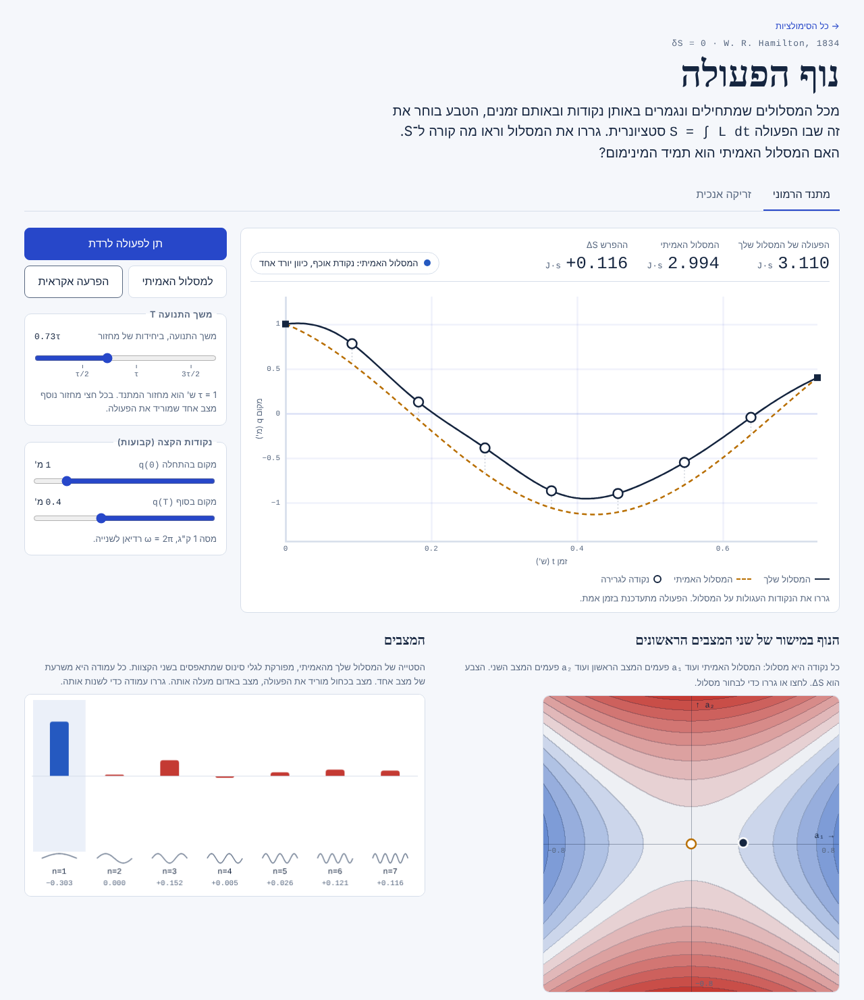

# נוף הפעולה

סימולציה אינטראקטיבית של עקרון המילטון. גוררים מסלול בין שתי נקודות קבועות ורואים איך הפעולה <code>S = ∫ L dt</code> משתנה. המסלול האמיתי הוא תמיד נקודה סטציונרית, אבל לא תמיד מינימום.

*An interactive simulation of Hamilton's principle (Hebrew UI). Drag a trial path between fixed endpoints and watch the action change. For a vertical throw the true path is always a minimum; for the harmonic oscillator it turns into a saddle once the duration passes half a period. Plain HTML, CSS and JavaScript with no build step.*



## מה אפשר לעשות

- **גרירת המסלול**: שבע נקודות על המסלול נגררות למעלה ולמטה. הפעולה של המסלול, של המסלול האמיתי וההפרש ביניהן מתעדכנים בזמן אמת.
- **שתי מערכות**: מתנד הרמוני וזריקה אנכית.
- **משך התנועה T**: במתנד הוא נמדד ביחידות של מחזור, וחצאי המחזור מסומנים על המחוון.
- **נוף הפעולה**: מפת צבע של ΔS במישור של שני המצבים הראשונים. כחול מתחת לפעולה של המסלול האמיתי, אדום מעליה. כשהמסלול האמיתי הוא מינימום רואים קערה, וכשהוא נקודת אוכף רואים אוכף.
- **המצבים**: הסטייה מהמסלול האמיתי מפורקת לשבעה גלי סינוס, עם התרומה של כל אחד ל־ΔS. אפשר לגרור כל עמודה.
- **"תן לפעולה לרדת"**: כל מצב זז בכיוון שמוריד את הפעולה. כשהמסלול האמיתי הוא מינימום המסלול חוזר אליו. כשהוא נקודת אוכף הפעולה יורדת בלי גבול.

## הפיזיקה

שתי המערכות ריבועיות:

| מערכת | לגראנז'יאן |
| --- | --- |
| זריקה אנכית | `L = ½ m q̇² − m g q` |
| מתנד הרמוני | `L = ½ m q̇² − ½ m ω² q²` |

כל מסלול נבנה כמסלול האמיתי ועוד סכום של גלי סינוס שמתאפסים בקצוות, `q(t) = q_true(t) + Σ aₙ sin(nπt/T)`. בגלל שהמסלול האמיתי מקיים את משוואת אוילר–לגראנז' והמצבים אורתוגונליים, הפעולה יוצאת בדיוק

```
S = S_true + Σ cₙ aₙ²,    cₙ = (mT/4)·[(nπ/T)² − ω²]
```

בזריקה אנכית `ω = 0`, כל המקדמים חיוביים, והמסלול האמיתי הוא מינימום לכל T. במתנד, `c₁` נעשה שלילי כש־T עובר חצי מחזור, ומכאן שהמסלול האמיתי הוא נקודת אוכף. כל חצי מחזור נוסף מוסיף מצב שמוריד את הפעולה (אינדקס מורס). בדיוק בחצי מחזור יש נקודה צמודה, ואין מסלול אמיתי בין שתי נקודות כלליות.

הנושא מופיע בסעיפים 2.1–2.3 בספר *Classical Mechanics* של Goldstein, Poole ו־Safko.

## מבנה הקבצים

```
index.html          הדף
style.css           העיצוב (בהיר וכהה)
action.js           הפיזיקה: מסלולים אמיתיים, פירוק למצבים, הפעולה
app.js              הציור והאינטראקציה
tests/              בדיקות לפיזיקה
docs/screenshot.png צילום המסך שמוצג כאן
```

שבע נקודות הגרירה ושבע משרעות המצבים קשורות בהתמרת סינוס בדידה (DST-I), ולכן כל גרירה קובעת מסלול חלק אחד.

## הרצה ובדיקות

אין צורך בהתקנה. אפשר לפתוח את `index.html` בדפדפן, או להריץ `python3 -m http.server 8000`.

הבדיקות (Node.js 18 ומעלה):

```bash
npm test
```

הן מוודאות שהמסלולים האמיתיים פותרים את משוואת התנועה, שהפעולה הסגורה של המסלול האמיתי מתאימה לאינטגרציה נומרית, שהנוסחה `ΔS = Σ cₙ aₙ²` מתאימה לאינטגרציה נומרית עבור הפרעות אקראיות, ושאינדקס מורס גדל באחד בכל חצי מחזור.

## כתובת

`https://michaelrabino.github.io/physics-simulations/analytical_mechanics/action-landscape/`
