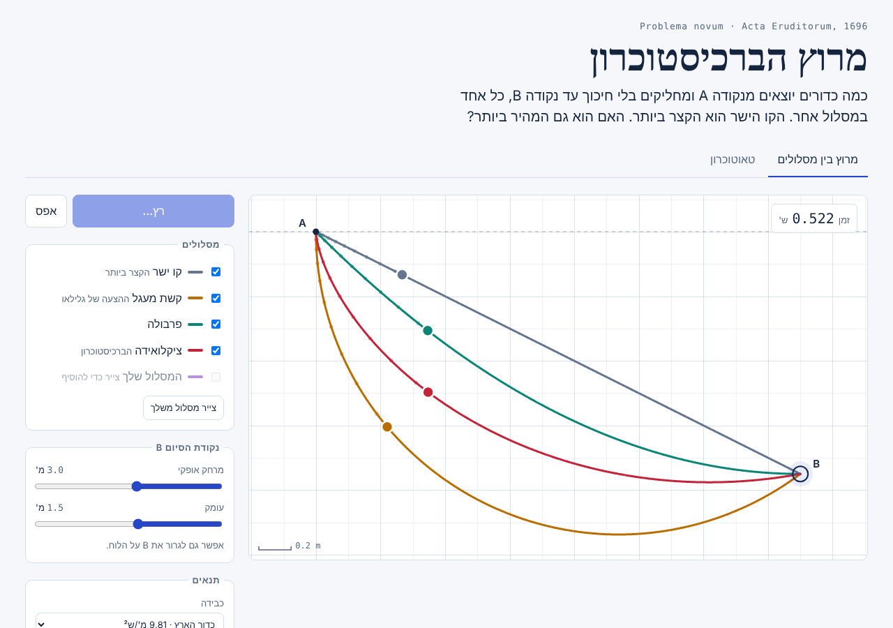

# מרוץ הברכיסטוכרון

סימולציה אינטראקטיבית של בעיית הברכיסטוכרון: כמה כדורים מחליקים בלי חיכוך מנקודה A לנקודה B, כל אחד במסלול אחר, ורואים מי מגיע ראשון. הציקלואידה מנצחת תמיד, גם כשהקו הישר קצר ממנה.

*An interactive simulation of the brachistochrone problem (Hebrew UI). Beads slide without friction from A to B along a straight line, a circular arc, a parabola, a cycloid and a curve you draw yourself. Plain HTML, CSS and JavaScript with no build step.*



## מה אפשר לעשות

- **מרוץ בין מסלולים**: קו ישר, קשת מעגל, פרבולה, ציקלואידה ומסלול שמציירים ביד.
- **הזזת נקודת הסיום**: בעזרת המחוונים או בגרירה של B על הלוח. כש־B רחוקה ונמוכה מספיק, הציקלואידה יורדת מתחת ל־B ועולה אליה בסוף.
- **טאוטוכרון**: ארבעה כדורים משתחררים מגבהים שונים על ציקלואידה ומגיעים לתחתית באותו רגע. במסילה מעגלית, להשוואה, הזמנים שונים.
- **כבידה**: כדור הארץ, הירח, מאדים או צדק.
- **האטה** ל־½× או ל־¼×, וסימון מיקום כל כדור כל 0.05 שנייה.
- **טבלת תוצאות** עם הזמן המדוד, הזמן לפי הנוסחה הסגורה (לקו הישר ולציקלואידה) והפער מהציקלואידה.
- **גרף מהירות** של כל כדור לאורך הזמן.

## איך החישוב נעשה

כל מסלול מחולק לכ־1500 קטעים ישרים. מהירות הכדור בעומק h מתחת לנקודת השחרור היא `v = √(2gh)`, ועל כל קטע התאוצה קבועה, ולכן הזמן לחצות קטע באורך L הוא בדיוק

```
dt = 2L / (v_start + v_end)
```

כך אין בעיה עם ההתחלה ממנוחה (v = 0), והתנועה בתוך כל קטע מחושבת בדיוק ולא בצעדי זמן. הזמנים שמתקבלים עבור הקו הישר והציקלואידה מתאימים לנוסחאות הסגורות:

| מסלול | זמן |
| --- | --- |
| קו ישר | `T = √(2(X² + Y²) / (gY))` |
| ציקלואידה `x = R(θ − sin θ), y = R(1 − cos θ)` | `T = θ_B · √(R/g)` |
| טאוטוכרון (מכל נקודת שחרור) | `T = π · √(R/g)` |

הנושא מופיע בסעיף 2.2 בספר *Classical Mechanics* של Goldstein, Poole ו־Safko.

## מבנה הקבצים

```
index.html          הדף
style.css           העיצוב (בהיר וכהה)
physics.js          הפיזיקה: המסלולים, חישוב הזמנים והתנועה
app.js              הציור, הפקדים והשעון
tests/              בדיקות לפיזיקה מול הנוסחאות הסגורות
docs/screenshot.png צילום המסך שמוצג כאן
```

`physics.js` לא תלוי בדפדפן, ולכן אותו קוד רץ גם בדף וגם בבדיקות.

## הרצה מקומית

אין צורך בהתקנה או בבנייה. אפשר לפתוח את `index.html` בדפדפן בלחיצה כפולה, או להריץ שרת מקומי:

```bash
python3 -m http.server 8000
# ואז לפתוח http://localhost:8000
```

## בדיקות

נדרש Node.js בגרסה 18 ומעלה:

```bash
npm test
```

הבדיקות מוודאות, בין השאר, שזמן הציקלואידה מתאים ל־`θ_B·√(R/g)` עד רבבית, שהציקלואידה מהירה מכל המסלולים האחרים, ושבטאוטוכרון כל הכדורים מגיעים יחד.

## פרסום ב־GitHub Pages

1. הסימולציה נמצאת בתיקייה `analytical_mechanics/brachistochrone` במאגר `physics-simulations`.
2. במאגר: **Settings → Pages**.
3. תחת **Build and deployment** בוחרים **Deploy from a branch**, את הענף `main` ואת התיקייה `/ (root)`.
4. אחרי דקה או שתיים הסימולציה זמינה בכתובת `https://michaelrabino.github.io/physics-simulations/analytical_mechanics/brachistochrone/`.
