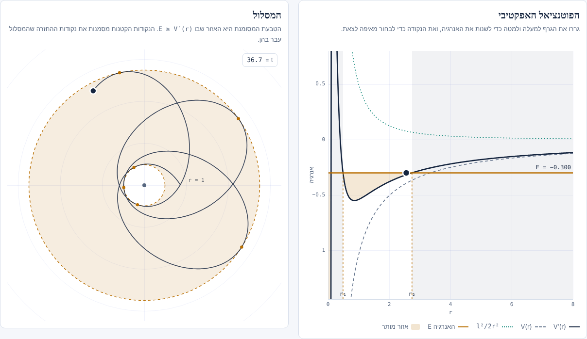

# מעבדת הפוטנציאל האפקטיבי

סימולציה אינטראקטיבית של בעיית הכוח המרכזי. גרף הפוטנציאל האפקטיבי <code>V′(r)</code>, עם קו האנרגיה ונקודות ההחזרה, מוצג לצד המסלול שנובע ממנו. גוררים את האנרגיה ואת התנע הזוויתי, ורואים את המעבר בין מסלול מעגלי, חסום, פתוח ונפילה למרכז.

*An interactive central-force lab (Hebrew UI). The effective potential with the energy line and turning points sits next to the orbit it produces. Five potentials: Kepler, isotropic oscillator, attractive 1/r⁴ force, Yukawa, and Kepler with the relativistic 1/r³ term. Plain HTML, CSS and JavaScript with no build step.*



## מה אפשר לעשות

- **לגרור את האנרגיה** על הגרף של V′ (או במחוון), ואת הנקודה שעל קו האנרגיה כדי לבחור מאיזה רדיוס יוצאים.
- **לשנות את התנע הזוויתי l** ולראות את המחסום הצנטריפוגלי גדל או קטן.
- **לבחור פוטנציאל**: קפלר, מתנד איזוטרופי, כוח מושך <code>1/r⁴</code>, יוקאווה (עם טווח a) או קפלר עם תיקון יחסותי (עם עוצמה ε).
- **לשחרר** ולראות את המסלול. הנקודה על הגרף זזה בין נקודות ההחזרה יחד עם החלקיק, והקו האנכי מתחתיה הוא האנרגיה הקינטית הרדיאלית.
- **מסלול מעגלי**: קובע את האנרגיה במינימום של V′. בכוח <code>1/r⁴</code>, שבו יש ל־V′ רק מקסימום, נקבע מסלול מעגלי לא יציב, והחלקיק עוזב אותו אחרי זמן קצר.
- **תוצאות**: סוג המסלול, נקודות ההחזרה, הזווית Δθ בין שתי נקודות החזרה (והאם היא שבר פשוט של π, כלומר המסלול נסגר), והמחזור הרדיאלי.

## הפיזיקה

עם מסה מצומצמת μ = 1 ועוצמת כוח 1:

```
E = ½ ṙ² + V′(r),     V′(r) = V(r) + l²/(2r²)
```

נקודות ההחזרה הן הפתרונות של `E = V′(r)`. במסלול חסום, הזווית והמחזור הרדיאלי הם

```
Δθ  = ∫ l/r² · dr / √(2(E − V′))      מ־r₁ עד r₂
T_r = 2 ∫ dr / √(2(E − V′))
```

ומחושבים בהצבה `r = c + h·sin φ` שמבטלת את הסינגולריות בקצוות. בקפלר Δθ = π ובמתנד Δθ = π/2, ולכן המסלולים נסגרים (משפט ברטרנד). ביוקאווה ובתיקון היחסותי Δθ > π והפריהליון מתקדם.

המסלול עצמו מחושב בנפרד, בקואורדינטות קרטזיות עם אינטגרטור Dormand–Prince מסדר 5 עם צעד משתנה, כך שהתמונה לא נשענת על הניתוח החד־ממדי שהיא אמורה להמחיש.

הנושא מופיע בסעיפים 3.1–3.7 בספר *Classical Mechanics* של Goldstein, Poole ו־Safko.

## מבנה הקבצים

```
index.html          הדף
style.css           העיצוב (בהיר וכהה)
central.js          הפיזיקה: הפוטנציאלים, נקודות החזרה, Δθ, המחזור, האינטגרטור
app.js              הציור והאינטראקציה
tests/              בדיקות לפיזיקה
docs/screenshot.png צילום המסך שמוצג כאן
```

## הרצה ובדיקות

אין צורך בהתקנה. אפשר לפתוח את `index.html` בדפדפן, או להריץ `python3 -m http.server 8000`.

הבדיקות (Node.js 18 ומעלה):

```bash
npm test
```

הן בודקות את נקודות ההחזרה של קפלר מול המשוואה הריבועית, Δθ = π ו־`T = 2π a^1.5` בקפלר, Δθ = π/2 ו־T = π במתנד, קדימת פריהליון ביוקאווה ובתיקון היחסותי, נפילה למרכז בכוח <code>1/r⁴</code>, ושימור אנרגיה ותנע זוויתי באינטגרטור לאורך עשר הקפות.

## כתובת

`https://michaelrabino.github.io/physics-simulations/analytical_mechanics/effective-potential/`
